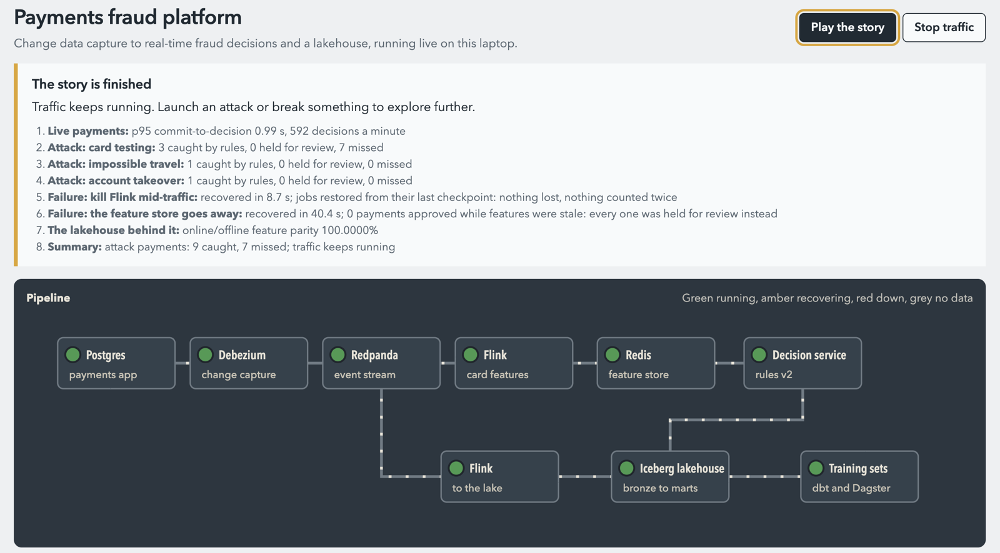
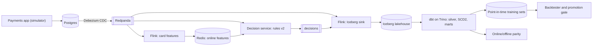
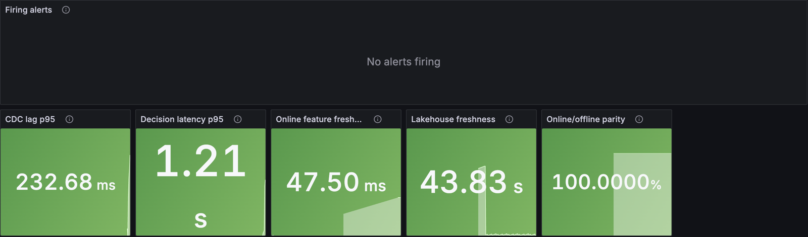
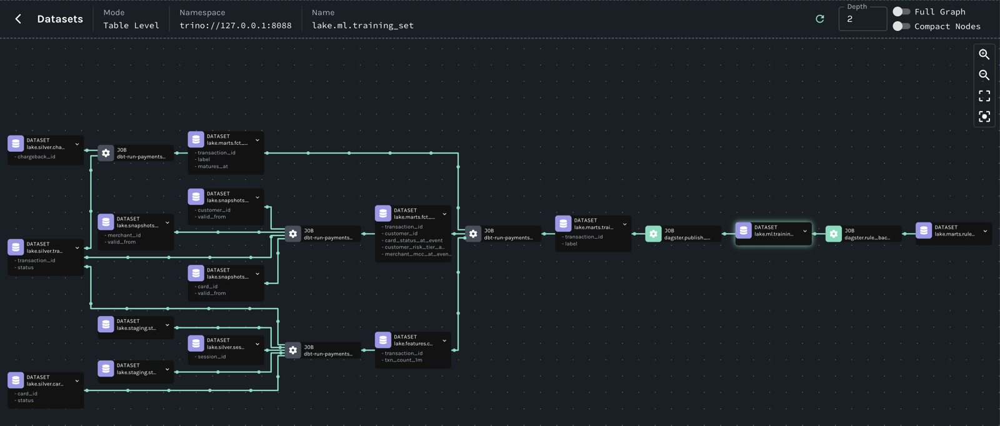

# Payments fraud platform

Change data capture from a payments database to a fraud decision for every payment in about a
second, and a lakehouse that keeps every change, builds leak-free training sets and proves the
real-time features right. Everything runs on one laptop with open-source tools.

**p95 decision 1.21 s from database commit · 100.0000% online/offline feature parity over
205,974 decisions**



Run it with `make demo` (one page, an eight-minute narrated story), or browse the
[data models and lineage](https://odedlaufer.github.io/payments-fraud-platform/) published from
`main`.

## What it does

A simulated payments app writes customers, cards, merchants, sessions, transactions and
chargebacks to Postgres, with five fraud patterns mixed into the traffic. From there, one stream
of change events feeds two paths.



- **Hot path, in seconds.** Debezium captures every insert, update and delete. Flink keeps
  rolling card features (counts and sums over 1 minute to 30 days, distance and time between
  in-person payments) and writes them to Redis. The decision service applies versioned rules
  and publishes approve, review or decline with the exact features it used.
- **Cold path, the full history.** Every change and every decision lands in Apache Iceberg.
  dbt rebuilds current state, full history (SCD2), facts joined as they were at payment time,
  labels with the moment they became known, and point-in-time training sets.
- **Where the paths meet.** The lakehouse recomputes every feature offline and compares it with
  what each decision actually used: that is the parity number above.

## Why it is built this way

Fraud systems fail on data more often than on models:

- **The source of truth is a database that changes in place.** Card status, customer email and
  transaction status are overwritten; analytics needs every change. CDC captures them all
  without touching the application.
- **Labels arrive weeks late.** A chargeback lands 1 to 60 days after the payment, so a naive
  training set learns from the future.
- **Real-time and batch features drift apart.** Each feature is defined once
  ([feature catalogue](docs/feature-catalogue.md)) and computed by both paths; parity is
  measured daily and alerted below 99.9%.
- **Rules change blind.** Here every rule version is backtested first, and a promotion gate
  refuses one that loses precision.

## Results

Measured on a MacBook (Docker with 12 GB) at 20 payments per second. Targets are the PRD's;
the [SLO run report](docs/slo-report.md) has every minute of a seven-simulated-week run.

| Service level | Target | Measured |
| --- | --- | --- |
| Decision latency p95 (Postgres commit to decision) | under 5 s | **1.21 s** |
| Change capture lag p95 (commit to event in Redpanda) | under 2 s | **233 ms** |
| Online feature freshness p95 | under 5 s | **47.5 ms** |
| Lakehouse freshness (newest Iceberg commit) | under 5 min | **44 s** |
| Online/offline feature parity | at least 99.9% | **100.0000%** over 205,974 decisions |
| Change capture completeness | every row | Postgres and the change log reconcile key by key (also in CI) |
| Point-in-time leakage | 0 rows | 0: a leakage test blocks publishing |
| Backtest reproducibility | identical | the same rules and snapshot give a byte-identical report |



Every service level is a Grafana panel with a Prometheus alert behind it. All nine alerts have
promtool unit tests; CDC stalled, stale features, Flink unhealthy and the dead-letter spike also
fired in live tests.

## Fraud patterns and how each is caught

The simulator injects five patterns and records the truth in a table the pipeline never sees.
Precision below is per rule on the latest full training set (71,423 transactions, 1,091 fraud).

| Pattern | What the features see | Rule | Precision |
| --- | --- | --- | --- |
| Account takeover | new device, changed email or phone, then a large purchase | account_takeover | 85.0% |
| Impossible travel | two in-person payments too far apart for the time between them | impossible_travel | 62.5% |
| Card testing | many tiny payments on one card at many merchants within minutes | card_testing | 30.3% |
| Bursts and spikes | velocity and amount far above the card's own history | velocity_burst, spend_spike, daily_spend | 28 to 55% |
| Merchant bust-out | a merchant's volume and refunds spike, then it disappears | none yet | a known gap |
| Friendly fraud | a normal payment later disputed | none possible | label noise, by design |

## Rule changes are backtested before they go live

The backtester replays any rule version over a published training set with the same rule engine
the decision service runs. Version 2 added the account takeover rule:

| Overall | v1 | v2 | Change |
| --- | ---: | ---: | ---: |
| Precision | 38.47% | 45.40% | +6.93 pp |
| Recall | 41.43% | 57.38% | +15.95 pp |
| Alert rate | 1.65% | 1.93% | +0.29 pp |
| Fraud declined | $14,232 | $329,806 | +$315,574 |
| Legitimate payments declined | $6,136 | $63,912 | +$57,776 |

`make promote-rules` makes a version live only if its precision keeps at least 90% of the live
version's and parity is within its target; it refused a decline-everything version and a
rollback to v1. On GitHub, every pull request that touches `rules/` gets this comparison as a
comment.

## Training sets without leakage

A training set is built for a cutoff date, using only what was known at that moment:

```text
  payment's event time          cutoff minus 60 days                      cutoff
  ─────────────●──────────────────────────┼─────────────────────────────────┼──▶ time
               features as of this        transactions newer than this       labels known
               moment (SCD2 joins)        are left out: their label          after this
                                          may not have arrived yet           are ignored
```

Each published set is pinned to an Iceberg snapshot and tagged, so any past training set can be
reproduced exactly, and a leakage test fails the build if any feature or label crosses its
boundary.

## Failure tests

`make chaos` injects six failures during live traffic and checks the expected outcome with the
platform's own checks ([full results](docs/chaos.md)).

| Failure | Measured outcome |
| --- | --- |
| Flink TaskManager killed | fresh decisions back in 19.4 s; restored from checkpoint, no record lost or counted twice |
| Kafka Connect stopped for 5 minutes | CdcStalled alert fired; Debezium resumed in 10 s; zero missing rows |
| Redis stopped for 2 minutes | all 2,350 decisions in the outage held for review, 0 approved |
| Malformed events | dead-lettered in 10 s with no restarts; replayable |
| Breaking schema change | rejected by the schema registry or the contract check |
| Event 3 hours late | counted in the late-events topic in 5 s; reviewed, not approved |

## Lineage, contracts and quality



- **Lineage:** OpenLineage events from dbt, Dagster and the streaming jobs connect
  `public.transactions` in Postgres to `ml.training_set` in Marquez.
- **Contracts:** the decisions topic, the silver tables and the training set have ODCS data
  contracts, tested live against Trino; CI refuses a breaking change without a major version.
- **Quality gates:** Dagster blocks everything downstream when silver stops matching Postgres;
  dead letters, late events and stale features each have a metric and an alert.

## Run it

Needs Docker Desktop with 12 GB of memory, [uv](https://docs.astral.sh/uv/) and make. Tested
on a 24 GB MacBook.

```bash
make setup          # once: dependencies, git hooks, .env
make present        # everything up and the demo console at http://localhost:8090
make present-stop   # everything down, data kept
```

`make present` starts only this project's containers. If other Docker projects are running, it
lists them with their memory and stops them only if you agree, then offers to start them again
on `make present-stop`.

| Command | What it does |
| --- | --- |
| `make check` | lint, types and the test suite, as CI runs them |
| `make sim` | payments traffic at 20 per second |
| `make backtest RULES=...` | backtest rule versions on the latest training set |
| `make chaos` | the six failure tests |
| `make orchestrate` | Dagster at http://localhost:3070 |
| `make health` | every service, its lag and its slot, checked |

Presenting it: [docs/demo.md](docs/demo.md) is a ten-minute script with answers to the usual
questions.

## Trade-offs, and what changes at scale

- **One of everything.** A single broker, one Flink TaskManager and a small Trino keep the
  stack inside a laptop's memory. At scale: several brokers and TaskManagers, a managed catalog
  and object store.
- **Rules, not a model.** The training sets are the deliverable; a model would sit next to the
  rules and be promoted through the same backtest gate.
- **Redis as the online store.** It is rebuilt from the feature topic after a restart (five to
  nine minutes here); a managed feature store or persistent state would shorten that.
- **Labels from a simulator.** Fraud is synthetic and labelled, so results can be explained;
  friendly fraud and overlapping legitimate behaviour keep precision honest.

## Engineering

- **CI on GitHub:** lint, types and unit tests; the real Postgres, Redpanda and Debezium stack
  on every pull request with change capture reconciled; rule backtests on pull requests; docs
  published on merge.
- **Decisions and incidents:** [architecture decisions](docs/adr) and
  [incident write-ups](docs/incidents) record what was chosen, what broke and how it was found.

| Path | Contents |
| --- | --- |
| `simulator/` | payments app simulator and the five fraud patterns |
| `postgres/`, `connect/` | the OLTP schema and Debezium |
| `flink/`, `features/` | streaming features and Iceberg sinks; one feature definition file |
| `decision_service/`, `rules/` | real-time decisions and the shared rule engine |
| `dbt/` | silver, SCD2, marts, training sets, parity |
| `backtester/`, `orchestration/` | rule backtests; Dagster assets, schedules and gates |
| `contracts/`, `observability/` | data contracts; Prometheus, Grafana, alerts |
| `chaos/`, `demo/` | failure tests; the demo console |

MIT licence. All data is synthetic.
